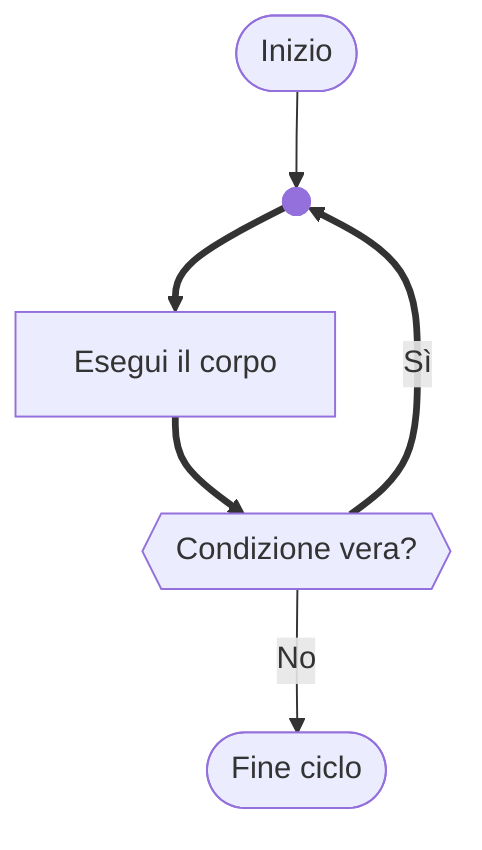

# Il ciclo `do-while`

## Teoria

Il ciclo `do-while` è simile al `while` con una differenza cruciale: la condizione viene valutata **dopo** il corpo, non prima.

> *"Esegui questo blocco, poi controlla: se la condizione è ancora vera, ripeti."*

Questo garantisce che il corpo venga eseguito **almeno una volta**, indipendentemente dalla condizione iniziale.



## Sintassi

```c
do {
    /* corpo del ciclo */
} while (condizione);   /* <-- nota il punto e virgola finale: è obbligatorio */
```


> [!CAUTION]
> **Attenzione all'errore — Il punto e virgola dopo `while`**
>
> Nel `do-while` il `;` finale è **obbligatorio** — è parte della sintassi. Nel `while` normale invece `while (cond);` senza corpo crea un ciclo che non fa nulla (ciclo vuoto), spesso un bug. La differenza è sottile ma il compilatore non si lamenta in nessuno dei due casi.

## Implementazione in C

Il `do-while` eccelle nei **menu interattivi**: il menu deve essere mostrato almeno una volta, poi si ripete solo se l'utente sceglie di continuare.

```c
/* Esempio — Menu di un negozio virtuale */
#include <stdio.h>

int main(void) {
    int scelta;
    float totale = 0.0f;
    float prezzo;

    do {
        /* il menu viene stampato almeno una volta */
        printf("\n=== NEGOZIO ===\n");
        printf("1. Aggiungi articolo\n");
        printf("2. Visualizza totale\n");
        printf("0. Esci\n");
        printf("Scelta: ");
        scanf("%d", &scelta);

        if (scelta == 1 ) {
            printf("Prezzo articolo (€): ");
            scanf("%f", &prezzo);
            if (prezzo > 0.0f) {
                totale += prezzo;  /* += equivale a totale = totale + prezzo */
                printf("Articolo aggiunto. Totale parziale: €%.2f\n", totale);
            } else {
                printf("Prezzo non valido.\n");
            }
        } else if (scelta == 2) {
            printf("Totale carrello: €%.2f\n", totale);
        } else if (scelta == 0) {
            printf("Arrivederci! Totale finale: €%.2f\n", totale);
        } else {
            printf("Scelta non valida.\n");
        }
    } while (scelta != 0);   /* ripeti finché l'utente non sceglie 0 */

    return 0;
}
```

> [!TIP]
> **Curiosità — `while` vs `do-while`: quale scegliere?**
>
> Usa `do-while` quando il corpo **deve** essere eseguito almeno una volta per avere senso (menu, richieste di input obbligatorie). Usa `while` quando è possibile che il ciclo non venga mai eseguito (elaborazione di una lista che potrebbe essere vuota, attesa di una condizione che potrebbe già essere soddisfatta). Nella pratica, il `do-while` è usato molto meno spesso del `while` e del `for`, ma nei casi giusti rende il codice molto più pulito.
