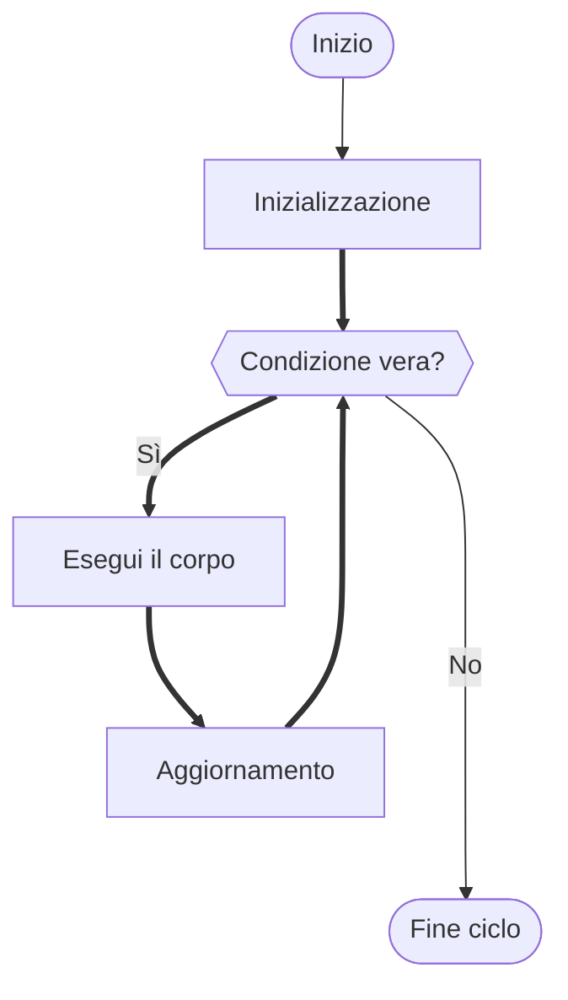

# Il ciclo `for`

## Teoria

Il ciclo `for` è progettato per le situazioni in cui si conosce in anticipo il numero di iterazioni, o si vuole esplicitare un **contatore**. Raccoglie in un'unica riga le tre componenti tipiche di un ciclo contatore:

1. **Inizializzazione** — eseguita una sola volta prima del ciclo.
2. **Condizione** — valutata prima di ogni iterazione; se falsa, il ciclo termina.
3. **Aggiornamento** — eseguito alla fine di ogni iterazione.



## Sintassi

```c
for (inizializzazione; condizione; aggiornamento) {
    /* corpo del ciclo */
}
```

Questo è **esattamente equivalente** a:

```c
inizializzazione;
while (condizione) {
    /* corpo */
    aggiornamento;
}
```

La differenza è solo di leggibilità: con `for`, chi legge vede subito tutte e tre le componenti del ciclo in un colpo d'occhio.

## Implementazione in C

```c
/* Esempio — Stampa dei primi N numeri e loro somma */
#include <stdio.h>

int main(void) {
    int n;

    printf("Quanti numeri vuoi sommare? ");
    scanf("%d", &n);

    int somma = 0;

    for (int i = 1; i <= n; i++) {   /* i parte da 1, arriva a n, aumentando di 1 */
        printf("%d", i);
        if (i < n){
            printf(" + ");    /* non stampare il + dopo l'ultimo numero */
        }
        somma += i;
    }
    printf(" = %d\n", somma);

    return 0;
}
```

Output per `n = 5`:
```
1 + 2 + 3 + 4 + 5 = 15
```

> [!TIP]
> **Curiosità — `int i` dentro il `for`**
>
> Dal C99 è possibile dichiarare la variabile di controllo direttamente nell'inizializzazione del `for`: `for (int i = 0; ...)`. La variabile esiste solo all'interno del ciclo — non è accessibile dopo. Questo è un buon esempio di **scope** (visibilità delle variabili): limitare la visibilità di una variabile al contesto in cui serve rende il codice più sicuro e leggibile.

**Iterazione su un intervallo con passo variabile:**

```c
/* Esempio — Tabellina di un numero */
#include <stdio.h>

int main(void) {
    int n;

    printf("Di quale numero vuoi la tabellina? ");
    scanf("%d", &n);

    for (int i = 1; i <= 10; i++) {
        printf("%d x %d = %d\n", n, i, n * i);
    }

    return 0;
}
```

**Contare all'indietro e con passo diverso da 1:**

```c
/* Esempio — Numeri pari da 20 a 0 (decrescente) */
#include <stdio.h>

int main(void) {
    for (int i = 20; i >= 0; i -= 2) {    /* passo -2: decremente di 2 ogni volta */
        printf("%d ", i);
    }
    printf("\n");
    return 0;
}
```

Output:
```
20 18 16 14 12 10 8 6 4 2 0
```

> [!WARNING]
> **Attenzione all'errore — Off-by-one: il bug più comune nei cicli**
>
> L'errore di *off-by-one* (sbagliare di uno il numero di iterazioni) è il bug più frequente con i cicli. Le varianti tipiche sono:
> - Scrivere `i < n` invece di `i <= n` (o viceversa) — il ciclo fa una iterazione in meno o in più.
> - Partire da `i = 0` quando si voleva partire da `i = 1` (o viceversa).
>
> **Regola pratica:** prima di scrivere il ciclo, chiediti *"quale valore ha `i` alla prima iterazione? E all'ultima?"* e verifica a mano che la condizione dia il risultato atteso in entrambi i casi.
