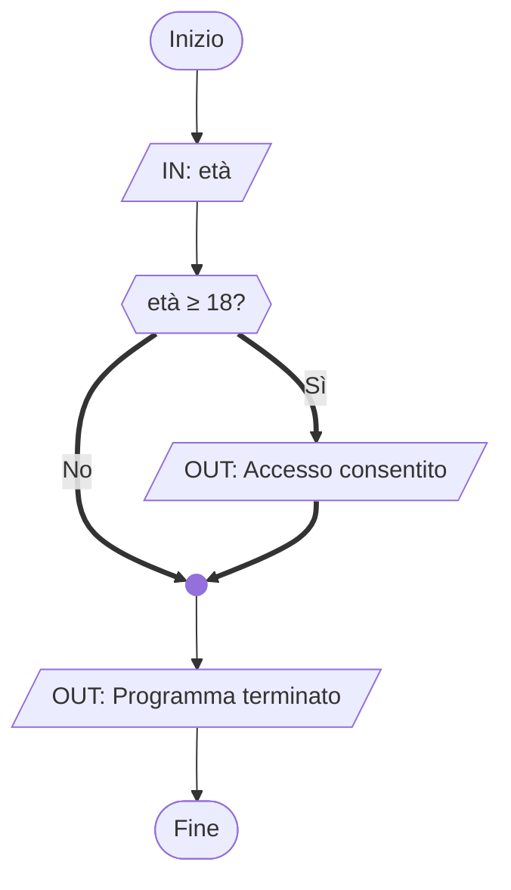

# Il costrutto `if`

## Teoria

L'istruzione `if` è il mattone fondamentale della selezione:

> *"Se questa condizione è vera, esegui questo blocco. Altrimenti, ignoralo e vai avanti."*

In C, una **condizione** è qualunque espressione intera: il linguaggio considera **falso** il valore `0` e **vero** qualsiasi valore diverso da zero. Con C23 è stato standardizzato il tipo `bool` e i valori `true`/`false`, specifici per le condizioni logiche.

Gli **operatori di confronto** producono condizioni:

| Operatore | Significato | Esempio |
|-----------|-------------|---------|
| `==` | uguale a | `a == 5` |
| `!=` | diverso da | `a != 0` |
| `<` | minore di | `a < 10` |
| `>` | maggiore di | `a > 0` |
| `<=` | minore o uguale | `a <= 100` |
| `>=` | maggiore o uguale | `a >= 18` |

> [!CAUTION]
> **Attenzione all'errore — La trappola dell'`=` singolo**
>
> `if (a = 5)` **non** verifica se `a` vale 5: *assegna* 5 ad `a`, poi valuta il risultato (che è 5, quindi vero!). Questo bug è silenzioso: il programma compila senza errori ma si comporta in modo sbagliato. Usa sempre `==` per il confronto. Alcuni programmatori usano il cosiddetto *Yoda style* — `if (5 == a)` — perché se scrivono per sbaglio `if (5 = a)` il compilatore si lamenta immediatamente, dato che non si può assegnare nulla alla costante `5`.

## Sintassi

```c
if (condizione) {
    /* istruzioni eseguite solo se condizione è vera */
}
```

Se il blocco contiene una sola istruzione le graffe sono tecnicamente opzionali, ma è **buona norma usarle sempre**: evitano errori sottili quando in seguito aggiungi righe al blocco.

> [!IMPORTANT]
> **Revisione — Il blocco `else` vuoto**
>
> In passato potresti aver scritto costrutti come:
> ```c
> if (condizione) {
>     /* fai qualcosa */
> } else {
>     /* niente */
> }
> ```
> Il blocco `else` vuoto non fa nulla di male, ma è superfluo: il programma si comporta esattamente allo stesso modo senza di esso. Quando l'unica azione è quella nel ramo `if`, puoi (e dovresti) omettere il ramo `else`.

## Implementazione in C

```c
/* Esempio — Accesso riservato ai maggiorenni */
#include <stdio.h>

int main(void) {
    int eta;

    printf("Inserisci la tua età: ");
    scanf("%d", &eta);          /* legge un intero da tastiera */

    if (eta >= 18) {            /* condizione: età maggiore o uguale a 18 */
        printf("Accesso consentito.\n");
    }
    /* se eta < 18 non succede nulla: il blocco viene saltato */

    printf("Programma terminato.\n");
    return 0;
}
```

**Traccia di esecuzione** per `eta = 20`:
```
Inserisci la tua età: 20
Accesso consentito.
Programma terminato.
```

**Traccia di esecuzione** per `eta = 15`:
```
Inserisci la tua età: 15
Programma terminato.
```

## Rappresentazione del flusso


