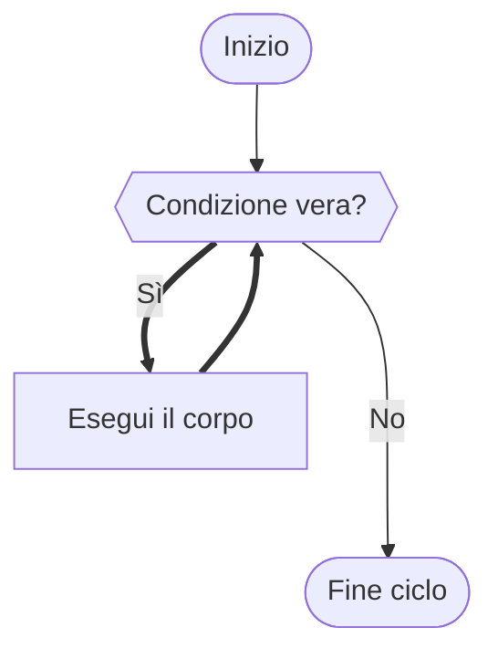

# Il ciclo `while`

## Teoria

Il ciclo `while` è la forma più semplice di iterazione:

> *"Finché questa condizione è vera, ripeti questo blocco."*

La condizione viene valutata **prima** di ogni esecuzione del corpo. Se è già falsa all'inizio, il corpo non viene mai eseguito — nemmeno una volta.



## Sintassi

```c
while (condizione) {
    /* corpo del ciclo */
}
```

## Implementazione in C

```c
/* Esempio — Countdown al lancio */
#include <stdio.h>

int main(void) {
    int n;

    printf("Inserisci il numero di partenza per il countdown: ");
    scanf("%d", &n);

    while (n > 0) {        /* continua finché n è positivo */
        printf("%d...", n);
        n--;               /* FONDAMENTALE: modifica la variabile di controllo */
    }
    printf("\nLancio!\n");

    return 0;
}
```

Output per `n = 5`:
```
5...4...3...2...1...
Lancio!
```

> [!WARNING]
> **Attenzione all'errore — Il ciclo infinito**
>
> Se dimentichi `n--` nell'esempio sopra, `n` non cambia mai e la condizione rimane sempre vera: il programma stampa `5...` per sempre (o fino a quando non lo interrompi con `Ctrl+C`). Ogni `while` deve contenere qualcosa che prima o poi renda falsa la condizione. Quando scrivi un ciclo, chiediti sempre: *"cosa cambia a ogni iterazione? Arriverò mai a fermarmi?"*

Un pattern classico è il ciclo di **lettura e validazione dell'input**:

```c
/* Esempio — Leggi un voto valido (0-10) */
#include <stdio.h>

int main(void) {
    int voto;

    printf("Inserisci un voto (0-10): ");
    scanf("%d", &voto);

    while (voto < 0 || voto > 10) {          /* ripeti finché l'input non è valido */
        printf("Voto non valido. Riprova: ");
        scanf("%d", &voto);
    }

    printf("Voto registrato: %d\n", voto);
    return 0;
}
```

Questo schema — *leggi, controlla, rileggi se necessario* — è uno dei più usati in pratica e si adatta naturalmente al `while`.
