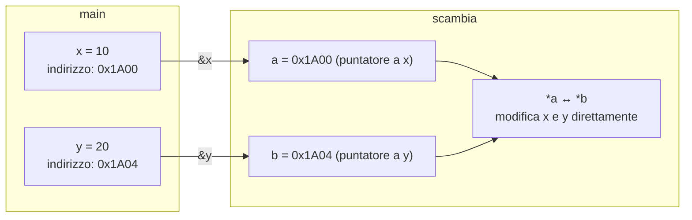

# Il passaggio per indirizzo (per riferimento)

## Teoria

Ora che capiamo i puntatori, possiamo risolvere il problema dello swap. Invece di passare i valori di `x` e `y`, passiamo i loro **indirizzi**: la funzione riceve i "numeri civici" delle variabili originali e può andare direttamente a modificarle.

Questo meccanismo si chiama **passaggio per indirizzo** (o *per riferimento* in altri linguaggi):



## Implementazione in C — swap corretto

```c
/* Esempio — swap per indirizzo: funziona */
#include <stdio.h>

/* I parametri sono puntatori a int, non int diretti */
void scambia(int *a, int *b) {
    int temp = *a;   /* legge il valore all'indirizzo a */
    *a = *b;         /* scrive in *a il valore letto da *b */
    *b = temp;       /* scrive in *b il valore salvato in temp */
}

int main(void) {
    int x = 10, y = 20;

    printf("Prima:  x = %d, y = %d\n", x, y);
    scambia(&x, &y);   /* passa gli indirizzi, non i valori */
    printf("Dopo:   x = %d, y = %d\n", x, y);

    return 0;
}
```

Output:
```
Prima:  x = 10, y = 20
Dopo:   x = 20, y = 10
```

Confronta la chiamata `scambia(&x, &y)` con quella precedente `scambia(x, y)`: la sola presenza di `&` fa tutta la differenza.

**Un altro esempio classico — funzione che restituisce due risultati:**

Una funzione può restituire un solo valore con `return`. Ma se ne servono due? Si usano i puntatori:

```c
/* Esempio — Calcola minimo e massimo in una sola funzione */
#include <stdio.h>

void min_max(int a, int b, int *min, int *max) {
    if (a < b) {
        *min = a;
        *max = b;
    } else {
        *min = b;
        *max = a;
    }
}

int main(void) {
    int x = 37, y = 15;
    int piccolo, grande;

    /* piccolo e grande vengono "riempiti" dalla funzione */
    min_max(x, y, &piccolo, &grande);

    printf("Minimo: %d\n", piccolo);
    printf("Massimo: %d\n", grande);

    return 0;
}
```

Questo pattern — parametri puntatore usati come "canali di output" — è molto comune nelle librerie C. Si trova, ad esempio, in `scanf`, che usa esattamente questo meccanismo (`scanf("%d", &n)` passa l'indirizzo di `n` alla funzione `scanf`, che ci scrive il valore letto).

> [!TIP]
> **Curiosità — Ora `scanf` ha senso**
>
> Ogni volta che hai scritto `scanf("%d", &n)` stavi già usando il passaggio per indirizzo senza saperlo. La `&` era necessaria proprio perché `scanf` deve *scrivere* nella tua variabile — e per farlo ha bisogno del suo indirizzo, non di una copia del valore.
