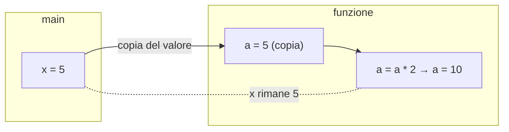

# Il Passaggio per valore

## Teoria

Quando chiami una funzione in C passandole una variabile, il linguaggio crea una **copia** del valore di quella variabile e la passa alla funzione. La funzione lavora sulla copia — l'originale rimane intatto.

Questo meccanismo si chiama **passaggio per valore** (*pass by value*) ed è il comportamento di default in C per tutti i tipi semplici (`int`, `float`, `char`, ecc.).



## Implementazione in C — La trappola dello swap

Il classico esempio che svela il passaggio per valore è la funzione `scambia`:

```c
/* Esempio — swap per valore: NON funziona */
#include <stdio.h>

void scambia(int a, int b) {
    int temp = a;   /* salva il valore di a in una variabile temporanea */
    a = b;
    b = temp;
    /* a e b sono copie locali: lo scambio avviene solo qui dentro */
}

int main(void) {
    int x = 10, y = 20;

    printf("Prima:  x = %d, y = %d\n", x, y);
    scambia(x, y);
    printf("Dopo:   x = %d, y = %d\n", x, y);  /* x e y sono ancora 10 e 20! */

    return 0;
}
```

Output:
```
Prima:  x = 10, y = 20
Dopo:   x = 10, y = 20
```

La funzione scambia le proprie copie locali, ma `x` e `y` nel `main` non vengono toccati. Per risolvere questo problema dobbiamo passare alla funzione non i valori, ma gli **indirizzi** delle variabili.
