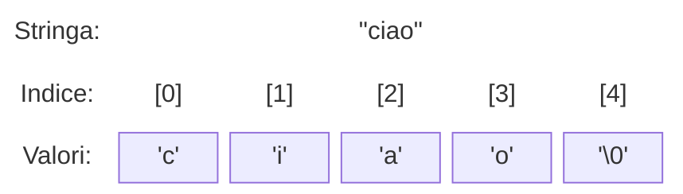
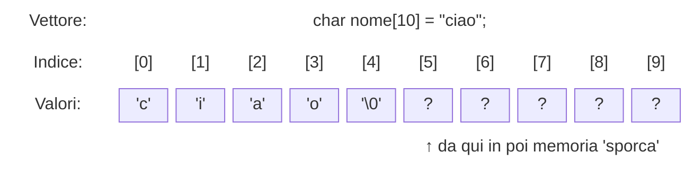

# Le stringhe come vettori di caratteri

## Teoria

In C non esiste un tipo `stringa` a sé stante: una **stringa** è semplicemente un **vettore di `char`** che rispetta una convenzione speciale.




L'ultimo elemento, `'\0'`, è il **carattere di terminazione** (detto anche *null character*). Non sono "due caratteri" — il backslash non produce un carattere aggiuntivo, è solo la notazione con cui si scrive **un singolo carattere** il cui codice numerico è 0. Esattamente come `'a'` è un carattere il cui codice ASCII è 97, `'\0'` è un carattere il cui codice è 0.

Questo terminatore è fondamentale: è l'**unico modo** che le funzioni sul C hanno per sapere dove finisce una stringa. Il vettore che la contiene può essere più grande del testo effettivo, ma tutto ciò che segue il `'\0'` viene semplicemente ignorato.




Da questa rappresentazione nasce il pericolo più comune legato alle stringhe in C: il **buffer overflow**. Se scriviamo in un vettore di caratteri più dati di quanti ce ne stiano — incluso lo spazio per il `'\0'` finale — scriviamo fuori dai suoi confini, in memoria che non ci appartiene. Il compilatore non ci avvisa: il programma può sembrare funzionare, per poi corrompere altre variabili o terminare con un errore di segmentazione, magari solo in certe esecuzioni.

> [!CAUTION]
> **Attenzione all'errore — Il `'\0'` occupa un posto**
>
> Un vettore `char nome[10]` può contenere al massimo **9 caratteri di testo utile** più il terminatore, per un totale di 10 elementi. Dimenticare di riservare spazio per `'\0'` è una causa frequente di buffer overflow.

## Sintassi — leggere una stringa in sicurezza

La funzione `scanf("%s", ...)`, usata senza precauzioni, non ha modo di sapere quanto è grande il vettore di destinazione: se l'utente digita più caratteri di quelli previsti, scrive comunque tutto, sconfinando dal vettore. Per evitarlo, si specifica un **numero massimo di caratteri** direttamente nella stringa di formato:

```c
/* Legge al massimo 9 caratteri (+ il '\0' finale, per un vettore di 10) */
scanf("%9s", nome);
```

> [!NOTE]
> **Perché la scanf sulle stringhe non vuole la &?**
>
> Per leggere variabili intere o float scriviamo la e-commerciale, mentre per le stringhe scriviamo semplicemente il nome della variabile. Questo avviene perchè il nome di un array rappresenta già l'indirizzo di memoria del suo primo elemento. Poiché la scanf vuole ricevere proprio un indirizzo di memoria in cui salvare i dati, passarle nome è già l'equivalente di passarle &nome[0].

Allo stesso modo, quando si costruisce o si copia una stringa con `sprintf`, si può limitare il numero di caratteri copiati dalla sorgente usando la **precisione** nel formato `%s`:

```c
/* Copia al massimo i primi 9 caratteri di origine in destinazione */
sprintf(destinazione, "%.9s", origine);
```

Anche qui vale la stessa regola: il vettore `destinazione` deve essere abbastanza grande da contenere quei caratteri più il terminatore.

> [!TIP]
> **Funzioni avanzate — Prevenzione del buffer overflow**
>
> Queste due tecniche — `scanf("%Ns")` in lettura e `sprintf("%.Ns")` in copia — bastano a scrivere codice sicuro per i nostri scopi. Il C mette a disposizione anche funzioni pensate apposta per la gestione sicura delle stringhe (come `fgets`, `strncpy` o `snprintf`), più flessibili ma anche più delicate da usare correttamente.

## Implementazione in C

```c
/* Esempio — Dichiarazione, lettura sicura e stampa di una stringa */
#include <stdio.h>

int main(void) {
    char nome[11];  /* 10 caratteri utili + 1 per '\0' */

    printf("Come ti chiami? ");
    scanf("%10s", nome);   /* al massimo 10 caratteri: 11 - 1 per il terminatore */

    printf("Ciao, %s!\n", nome);
    printf("Il carattere in posizione 0 e': %c\n", nome[0]);

    return 0;
}
```

```c
/* Esempio — Copia sicura di una stringa con sprintf */
#include <stdio.h>

int main(void) {
    char origine[] = "Programmazione";
    char copia[11]; /* 10 caratteri utili + 1 per '\0' */

    sprintf(copia, "%.10s", origine);  /* copia al massimo 10 caratteri */

    printf("Origine: %s\n", origine);
    printf("Copia:   %s\n", copia);    /* stampera' solo "Programma" */

    return 0;
}
```

## Le funzioni di `<string.h>`

La libreria standard `string.h` mette a disposizione funzioni pronte per lavorare sulle stringhe. Le due più usate sono `strlen` e `strcmp`, ed entrambe si basano esattamente sul meccanismo appena visto: **scorrono il vettore carattere per carattere finché non incontrano `'\0'`**.

- `strlen` conta quanti caratteri ci sono *prima* del terminatore — non lo include nel conteggio. Se `s` è `"ciao"`, la funzione parte dall'indice 0 e avanza (`'c'`, `'i'`, `'a'`, `'o'`) fermandosi non appena trova `'\0'` in posizione 4: il risultato è `4`, non `5`.

- `strcmp` confronta due stringhe carattere per carattere, avanzando in entrambe in parallelo, finché trova una differenza oppure raggiunge il `'\0'` in entrambe (stringhe uguali). Restituisce `0` se le stringhe sono identiche, un valore negativo se `s1` precede `s2` in ordine alfabetico, positivo altrimenti.

```c
/* Esempio — strlen e strcmp */
#include <stdio.h>
#include <string.h>

int main(void) {
    char parola[20];

    printf("Scrivi una parola: ");
    scanf("%19s", parola);

    printf("Lunghezza: %zu caratteri\n", strlen(parola));

    if (strcmp(parola, "fine") == 0) {
        printf("Hai scritto la parola magica!\n");
    } else {
        printf("Non e' la parola magica.\n");
    }

    return 0;
}
```
