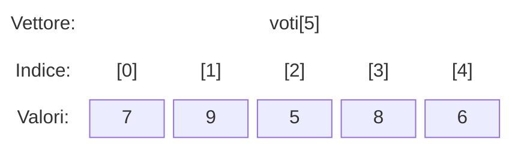

# Il vettore (array monodimensionale)

## Teoria

Un **vettore** (o *array*) è una sequenza di elementi dello **stesso tipo**, disposti in posizioni di memoria **contigue** e accessibili tramite un **indice** intero.

Pensa a un vettore come a una fila di cassetti numerati: ogni cassetto ha lo stesso formato, i cassetti sono uno accanto all'altro, e per aprire quello che vuoi basta conoscerne il numero.




Proprietà fondamentali:
- La **dimensione** è fissa e deve essere nota al momento della compilazione (per gli array statici).
- Gli **indici** partono da `0` e arrivano a `n-1` (per un array di `n` elementi).
- L'accesso a qualsiasi elemento ha lo stesso costo — si parla di **accesso diretto** o *random access*.
- Gli elementi sono in memoria uno dopo l'altro: `voti[1]` si trova esattamente `sizeof(int)` byte dopo `voti[0]`.

## Sintassi

```c
/* Dichiarazione */
tipo nome[dimensione];

/* Dichiarazione con inizializzazione */
tipo nome[dimensione] = {val0, val1, val2, ...};

/* Se si fornisce la lista completa, la dimensione può essere omessa */
tipo nome[] = {val0, val1, val2};   /* il compilatore conta gli elementi */
```

> [!CAUTION]
> **Attenzione all'errore — L'indicizzazione parte da 0**
>
> Ricorda sempre: un array di dimensione N ha indici validi che vanno da 0 a N-1.
> 
> Se dichiari int voti[5], l'elemento voti[5] non esiste (gli elementi sono voti[0], voti[1], voti[2], voti[3], voti[4]). Se provi ad accedere a voti[5], il compilatore non genererà alcun errore, ma andrai a toccare una zona di memoria esterna all'array. Questo causa un comportamento indefinito (segmentation fault o corruzione di altre variabili).

## Implementazione in C

```c
/* Esempio — Dichiarazione, inizializzazione e accesso */
#include <stdio.h>

int main(void) {
    int voti[5] = {7, 9, 5, 8, 6}; /* Dichiarazione con inizializzazione esplicita */

    /* Accesso in lettura tramite indice */
    printf("Primo voto:  %d\n", voti[0]);
    printf("Ultimo voto: %d\n", voti[4]);

    voti[2] = 10;  /* Modifica di un elemento */
    printf("Terzo voto corretto: %d\n", voti[2]);

    /* Traversata con ciclo for: pattern fondamentale */
    printf("\nTutti i voti: ");
    for (int i = 0; i < 5; i++) {
        printf("%d ", voti[i]);
    }
    printf("\n");

    return 0;
}
```

**Inizializzazione a zero e input da tastiera:**

```c
/* Esempio — Lettura di un vettore da tastiera */
#include <stdio.h>
#define N 5    /* costante simbolica: evita i "numeri magici" nel codice */

int main(void) {
    int voti[N]; /* dichiarazione senza inizializzazione: contiene valori casuali! */

    printf("Inserisci %d voti (0-10):\n", N);
    for (int i = 0; i < N; i++) {
        printf("  Voto %d: ", i + 1);
        scanf("%d", &voti[i]);    /* &voti[i] = indirizzo dell'i-esimo elemento */
    }

    printf("\nVoti inseriti: ");
    for (int i = 0; i < N; i++) {
        printf("%d ", voti[i]);
    }
    printf("\n");

    return 0;
}
```

> [!TIP]
> **Curiosità — `#define` e i numeri magici**
>
> Scrivere `for (int i = 0; i < 5; i++)` con il `5` direttamente nel codice è chiamato *magic number*: chiunque legga il codice non capisce immediatamente cosa rappresenti. La costante `#define N 5` dà un nome significativo a quel valore e permette di cambiarlo in un unico punto. Se domani la classe ha 6 studenti, cambi solo `#define N 6` e tutto il codice si adatta automaticamente.
